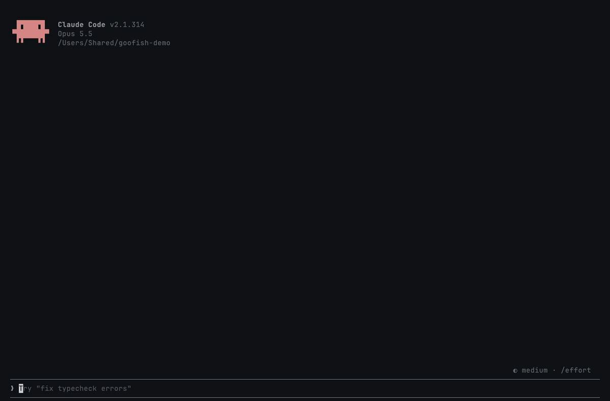

<div align="center">


# Goofish MCP Server

**Search Goofish (Xianyu, 闲鱼), China's largest second-hand marketplace, from Claude, ChatGPT, Cursor, VS Code, any MCP client or your own code.**

[](https://apify.com/zen-studio/goofish-xianyu-search-scraper)
[](#quick-start)
[](https://github.com/zen-studio-labs/goofish-mcp/actions/workflows/validate.yml)
[](LICENSE)

[](https://cursor.com/en/install-mcp?name=goofish&config=eyJ1cmwiOiJodHRwczovL21jcC5hcGlmeS5jb20vP3Rvb2xzPWZldGNoLWFjdG9yLWRldGFpbHMsZ2V0LWFjdG9yLXJ1bixnZXQtZGF0YXNldC1pdGVtcyxnZXQtZGF0YXNldC1saXN0LHplbi1zdHVkaW8vZ29vZmlzaC14aWFueXUtc2VhcmNoLXNjcmFwZXIsemVuLXN0dWRpby9nb29maXNoLXhpYW55dS1pdGVtLWRldGFpbC1zY3JhcGVyLHplbi1zdHVkaW8vZ29vZmlzaC14aWFueXUtc2VsbGVyLXNjcmFwZXIsemVuLXN0dWRpby9nb29maXNoLXhpYW55dS12aXN1YWwtc2VhcmNoLXNjcmFwZXIsemVuLXN0dWRpby9nb29maXNoLXhpYW55dS1pdGVtLWNvbW1lbnRzLXNjcmFwZXIifQ==)
[](https://vscode.dev/redirect/mcp/install?name=goofish&config=%7B%22type%22%3A%22http%22%2C%22url%22%3A%22https%3A%2F%2Fmcp.apify.com%2F%3Ftools%3Dfetch-actor-details%2Cget-actor-run%2Cget-dataset-items%2Cget-dataset-list%2Czen-studio%2Fgoofish-xianyu-search-scraper%2Czen-studio%2Fgoofish-xianyu-item-detail-scraper%2Czen-studio%2Fgoofish-xianyu-seller-scraper%2Czen-studio%2Fgoofish-xianyu-visual-search-scraper%2Czen-studio%2Fgoofish-xianyu-item-comments-scraper%22%7D)
[](https://insiders.vscode.dev/redirect/mcp/install?name=goofish&config=%7B%22type%22%3A%22http%22%2C%22url%22%3A%22https%3A%2F%2Fmcp.apify.com%2F%3Ftools%3Dfetch-actor-details%2Cget-actor-run%2Cget-dataset-items%2Cget-dataset-list%2Czen-studio%2Fgoofish-xianyu-search-scraper%2Czen-studio%2Fgoofish-xianyu-item-detail-scraper%2Czen-studio%2Fgoofish-xianyu-seller-scraper%2Czen-studio%2Fgoofish-xianyu-visual-search-scraper%2Czen-studio%2Fgoofish-xianyu-item-comments-scraper%22%7D&quality=insiders)
[](#client-setup)

[Quick start](#quick-start) · [Agent setup](#set-up-with-your-ai-agent) · [Tools](#tools) · [Client setup](#client-setup) · [Use from code](#use-it-from-code) · [Pricing](#pricing) · [FAQ](#faq) · [中文说明](#中文说明)

</div>

Goofish MCP connects your AI assistant to Goofish, the marketplace also known as Xianyu (闲鱼) and Idlefish. Ask in English or Chinese: your assistant searches listings, compares used prices, reads full item details, checks a seller's history and reviews, reads buyer questions, and finds listings that match a photo. Results come back as structured rows it can sort, filter, translate and summarise.



## Set up with your AI agent

Paste this repository's URL into Claude Code, Codex, Cursor or another agent and ask it to set up Goofish. The steps below are written so your agent can follow them.

**For AI agents installing this server:**

1. This is a hosted remote MCP server (streamable HTTP). There is nothing to download or build. It needs a free Apify account and an Apify sign-in (OAuth) in the user's browser; do not ask for an API token unless the sign-in fails.
2. Server name `goofish`, server URL:
   ```text
   https://mcp.apify.com/?tools=fetch-actor-details,get-actor-run,get-dataset-items,get-dataset-list,zen-studio/goofish-xianyu-search-scraper,zen-studio/goofish-xianyu-item-detail-scraper,zen-studio/goofish-xianyu-seller-scraper,zen-studio/goofish-xianyu-visual-search-scraper,zen-studio/goofish-xianyu-item-comments-scraper
   ```
3. Add it with the client's own command:
   - Claude Code: `claude plugin marketplace add zen-studio-labs/goofish-mcp`, then `claude plugin install goofish@goofish-mcp` (adds the server and the Goofish skill).
   - Codex: `codex mcp add goofish --url "<server URL>"`, then `codex mcp login goofish`.
   - VS Code: `code --add-mcp '{"name":"goofish","type":"http","url":"<server URL>"}'`.
   - Cursor and other clients: add `{"mcpServers": {"goofish": {"url": "<server URL>"}}}` to the client's MCP config file (Cursor: `~/.cursor/mcp.json`).
4. Ask the user to complete the sign-in. In Claude Code they run `/mcp`, select goofish and choose **Authenticate**; other clients open the Apify sign-in page themselves. A client restart may be needed before the tools appear.
5. Check it works with a small search, for example `keyword: "iPhone 15 Pro", maxItems: 5`. Every returned listing is billed to the user's Apify account, so keep test runs small.
6. Before real searches, read the [Goofish skill](skills/goofish/SKILL.md): it explains how long runs work and which inputs return good results.

## Why Goofish MCP

- **No Goofish account.** No login, no cookies, no Chinese phone number. Your own Goofish account is never involved.
- **Nothing to install.** A hosted remote MCP server: add one URL and sign in with Apify. Works in claude.ai and ChatGPT, not only in desktop apps.
- **Five tools in one server.** Listing search, item details, sellers and reviews, image search, and comments with buyer Q&A (问大家).
- **Rich, structured data.** 150+ fields per listing: price, condition, location, views and wants, shipping, seller credit, sales and response rate.
- **Made for assistants.** A bundled skill teaches your assistant the inputs that work, and long requests keep running while it checks back.
- **Pay per result.** Billed to your own Apify account. Try it on Apify's free plan.

| | Goofish MCP | Typical self-hosted Xianyu tools |
|---|---|---|
| Goofish account or cookies | Not needed | Usually required |
| Setup | One URL and an Apify sign-in | Python or Node, a local browser, exported cookies |
| Web assistants (claude.ai, ChatGPT) | Supported | Usually desktop clients only |
| Image search and buyer Q&A | Included | Rarely available |

## Tools

| Tool | What you get | Store page |
|---|---|---|
| Listing search | Listings for any keyword with price, condition, location, photos and seller stats. Filters for price, region, recency, personal sellers, free shipping, brand new and inspection verified. | [goofish-xianyu-search-scraper](https://apify.com/zen-studio/goofish-xianyu-search-scraper) |
| Item details | 150+ fields per listing: full description, every image, condition grade, views and wants, shipping, seller profile. | [goofish-xianyu-item-detail-scraper](https://apify.com/zen-studio/goofish-xianyu-item-detail-scraper) |
| Seller profile | Seller stats, credit badges, every listing tab including sold items, and transaction reviews. | [goofish-xianyu-seller-scraper](https://apify.com/zen-studio/goofish-xianyu-seller-scraper) |
| Image search | Listings that look like a photo you provide, optionally narrowed by brand or model. | [goofish-xianyu-visual-search-scraper](https://apify.com/zen-studio/goofish-xianyu-visual-search-scraper) |
| Comments and Q&A | The public comment thread under a listing, seller replies, and buyer Q&A (问大家). | [goofish-xianyu-item-comments-scraper](https://apify.com/zen-studio/goofish-xianyu-item-comments-scraper) |

All tools are read-only. They never buy, message sellers or post listings.

## Quick start

1. **Create a free [Apify account](https://console.apify.com/sign-up)** if you do not have one.
2. **Add the server to your assistant.** Click a button above, or follow the steps for your client below.
3. **Sign in with Apify when your assistant asks**, then ask a question such as *"Find used Sony A7 III camera bodies on Goofish between ¥5,000 and ¥8,000 from personal sellers and show five good options in a table."*

**About the Apify sign-in page.** Apify notes that your assistant "was registered dynamically and wasn't verified by Apify" and asks for full API access. Every assistant that signs in this way sees that notice; it lets your assistant start runs on your account. You can remove the access at any time on your [Apify Console integrations page](https://console.apify.com/account/integrations).

Server URL, for any client that accepts a remote MCP server:

```text
https://mcp.apify.com/?tools=fetch-actor-details,get-actor-run,get-dataset-items,get-dataset-list,zen-studio/goofish-xianyu-search-scraper,zen-studio/goofish-xianyu-item-detail-scraper,zen-studio/goofish-xianyu-seller-scraper,zen-studio/goofish-xianyu-visual-search-scraper,zen-studio/goofish-xianyu-item-comments-scraper
```

## Client setup

<details open>
<summary><b>Claude (claude.ai and Claude Desktop)</b></summary>

1. Open **Settings** > **Connectors** and select **Add custom connector**.
2. Name it `Goofish` and paste the server URL above.
3. Select **Connect** and sign in with Apify.
4. In a chat, enable the Goofish connector from the tools menu.

The connector syncs between claude.ai and Claude Desktop. Custom connector availability depends on your Claude plan. For better results, also add the [Goofish skill](skills/goofish/SKILL.md): zip the `skills/goofish` folder and upload it under **Skills** in Claude's settings.

</details>

<details>
<summary><b>Claude Code</b></summary>

Plugin (server plus the Goofish skill, recommended):

```text
/plugin marketplace add zen-studio-labs/goofish-mcp
/plugin install goofish@goofish-mcp
```

Server only:

```bash
claude mcp add --transport http goofish "https://mcp.apify.com/?tools=fetch-actor-details,get-actor-run,get-dataset-items,get-dataset-list,zen-studio/goofish-xianyu-search-scraper,zen-studio/goofish-xianyu-item-detail-scraper,zen-studio/goofish-xianyu-seller-scraper,zen-studio/goofish-xianyu-visual-search-scraper,zen-studio/goofish-xianyu-item-comments-scraper"
```

Then sign in: run `/mcp`, select the goofish server and choose **Authenticate**. Until you do, `/mcp` lists the server as not authenticated and may say its tools could not be fetched; both clear once you sign in.

</details>

<details>
<summary><b>Cursor</b></summary>

Click **Install in Cursor** above, or add [`examples/cursor-mcp.json`](examples/cursor-mcp.json) to `~/.cursor/mcp.json` (all projects) or `.cursor/mcp.json` (one project). Cursor asks you to sign in with Apify on first use.

</details>

<details>
<summary><b>VS Code and GitHub Copilot</b></summary>

Click **Install in VS Code** above, or add [`examples/vscode-mcp.json`](examples/vscode-mcp.json) to `.vscode/mcp.json`. Start the server from the MCP view and sign in with Apify when prompted. Use the tools in Copilot Chat agent mode.

</details>

<details>
<summary><b>ChatGPT</b></summary>

1. Open [ChatGPT Plugins](https://chatgpt.com/plugins), select **+**, then **Add custom MCP server**.
2. Name it `Goofish`, paste the server URL above, and choose **OAuth** authentication.
3. Confirm, create the plugin, and sign in with Apify.
4. In a new chat, type `@` and select **Goofish**.

Business, Enterprise and Edu workspaces may need an admin to enable custom servers. See OpenAI's [custom MCP server guide](https://help.openai.com/en/articles/12584461-connecting-custom-mcp-servers-in-chatgpt).

</details>

<details>
<summary><b>Codex</b></summary>

```bash
codex mcp add goofish --url "https://mcp.apify.com/?tools=fetch-actor-details,get-actor-run,get-dataset-items,get-dataset-list,zen-studio/goofish-xianyu-search-scraper,zen-studio/goofish-xianyu-item-detail-scraper,zen-studio/goofish-xianyu-seller-scraper,zen-studio/goofish-xianyu-visual-search-scraper,zen-studio/goofish-xianyu-item-comments-scraper"
codex mcp login goofish
```

Or copy [`examples/codex-config.toml`](examples/codex-config.toml) into `~/.codex/config.toml`.

</details>

<details>
<summary><b>Other clients, or a token instead of sign-in</b></summary>

Most clients that support remote MCP servers accept:

```json
{
  "mcpServers": {
    "goofish": {
      "url": "https://mcp.apify.com/?tools=fetch-actor-details,get-actor-run,get-dataset-items,get-dataset-list,zen-studio/goofish-xianyu-search-scraper,zen-studio/goofish-xianyu-item-detail-scraper,zen-studio/goofish-xianyu-seller-scraper,zen-studio/goofish-xianyu-visual-search-scraper,zen-studio/goofish-xianyu-item-comments-scraper"
    }
  }
}
```

If your client cannot complete the Apify sign-in, send your Apify token as a header instead, see [`examples/bearer-token-mcp.json`](examples/bearer-token-mcp.json). Copy the token from your [Apify Console integrations page](https://console.apify.com/account/integrations) and keep it out of shared files. Clients that only run local servers can bridge with `mcp-remote`, see [`examples/claude-desktop-config.json`](examples/claude-desktop-config.json).

</details>

## Use it from code

Each tool is also an [Apify Actor](https://apify.com/zen-studio) with a REST API, so you can call it from your own code, a pipeline or an automation, without an assistant. Copy your API token from the [Apify Console integrations page](https://console.apify.com/settings/integrations). The input fields are the same ones the assistant uses; each Store page has an **API** tab with ready-made code and the full input reference.

<details open>
<summary><b>Python</b></summary>

```bash
pip install apify-client
```

```python
import os
from apify_client import ApifyClient

client = ApifyClient(os.environ["APIFY_TOKEN"])
run = client.actor("zen-studio/goofish-xianyu-search-scraper").call(
    run_input={"keyword": "iPhone 15 Pro", "maxItems": 20, "sortBy": "priceAsc"}
)
for item in client.dataset(run["defaultDatasetId"]).iterate_items():
    print(item["price"], item["title"], item["url"])
```

</details>

<details>
<summary><b>JavaScript and TypeScript</b></summary>

```bash
npm install apify-client
```

```js
import { ApifyClient } from 'apify-client';

const client = new ApifyClient({ token: process.env.APIFY_TOKEN });
const run = await client.actor('zen-studio/goofish-xianyu-search-scraper').call({
    keyword: 'iPhone 15 Pro',
    maxItems: 20,
    sortBy: 'priceAsc',
});
const { items } = await client.dataset(run.defaultDatasetId).listItems();
console.log(items);
```

</details>

<details>
<summary><b>HTTP</b></summary>

Start a run and get its results in one request:

```bash
curl -X POST "https://api.apify.com/v2/acts/zen-studio~goofish-xianyu-search-scraper/run-sync-get-dataset-items" \
  -H "Authorization: Bearer $APIFY_TOKEN" \
  -H "Content-Type: application/json" \
  -d '{"keyword": "iPhone 15 Pro", "maxItems": 20}'
```

This waits up to 300 seconds. For bigger runs, start the run asynchronously and read its dataset when it finishes, see the [Apify API reference](https://docs.apify.com/api/v2/act-run-sync-get-dataset-items-post).

</details>

<details>
<summary><b>n8n, Make and Zapier</b></summary>

Use Apify's official integration for [n8n](https://docs.apify.com/platform/integrations/n8n), [Make](https://docs.apify.com/platform/integrations/make) or [Zapier](https://docs.apify.com/platform/integrations/zapier), choose the Actor (for example `zen-studio/goofish-xianyu-search-scraper`) and pass the same JSON input.

</details>

Other tools: replace the Actor ID with `zen-studio/goofish-xianyu-item-detail-scraper`, `zen-studio/goofish-xianyu-seller-scraper`, `zen-studio/goofish-xianyu-visual-search-scraper` or `zen-studio/goofish-xianyu-item-comments-scraper`.

## Example prompts

- *Find 30 used Nintendo Switch OLED listings on Goofish in Shanghai between ¥800 and ¥1,500, personal sellers only, cheapest first.*
- *Search 闲鱼 for 乐高 75313 and compare the five cheapest by condition and seller rating.*
- *What is the typical asking price for a used iPhone 15 Pro 256GB on Xianyu this week?*
- *Get the full details of this listing: https://www.goofish.com/item?id=1045244773159*
- *Look up this seller and summarise their last 50 reviews: https://www.goofish.com/personal?userId=2215160932230*
- *Find Goofish listings that look like this photo: https://example.com/my-jacket.jpg*
- *What are buyers asking on this listing, and how did the seller answer? https://www.goofish.com/item?id=947872178004*

Tip: write search terms the way sellers write titles. Use Chinese for Chinese brands and categories (`小米`, `乐高`, `手机`); international names such as `iPhone 15 Pro` work as they are.

## Use cases

- **Used-price research.** Typical asking prices for a model by condition and city, before you buy or sell.
- **Reselling and cross-border buying (代购).** Spot underpriced listings and check the seller before you commit.
- **Brand protection.** Find listings of your products, including look-alikes, by keyword or by photo.
- **Market research.** Read demand from views and wants across a category or a set of models.
- **Seller checks.** Credit level, sales count, response rate and recent reviews in one answer.

## Example output

One search row, abridged. Your assistant reads rows like this and answers in plain language.

```json
{
  "id": "1000000000001",
  "title": "索尼 A7M3 单机身 快门1.2万 几乎全新 带原装电池",
  "price": 6280,
  "currency": "CNY",
  "city": "上海",
  "condition": { "label": "几乎全新" },
  "postedAt": "2026-10-28T19:42:11+08:00",
  "freeShipping": true,
  "stats": { "views": 412, "wants": 23 },
  "seller": {
    "name": "摄影器材闲置",
    "creditLabel": "极好",
    "zhimaVerified": true,
    "stats": { "totalSold": 37, "goodReviewRate": "99%" }
  },
  "url": "https://www.goofish.com/item?id=1000000000001"
}
```

Each tool's Store page lists every field.

## How long requests work

Each tool call returns within about 45 seconds. Bigger requests keep running on Apify after that, and your assistant checks back until the results are ready, then reads them in pages. You may see a few "still running" updates; that is expected. The [Goofish skill](skills/goofish/SKILL.md) teaches assistants this flow, along with input recipes for each tool. Claude Code gets it with the plugin.

## Pricing

Pay per result, billed to your Apify account. There is no subscription to this repository. Current prices, including volume discounts, are on each tool's pricing page:

- [Listing search](https://apify.com/zen-studio/goofish-xianyu-search-scraper/pricing)
- [Item details](https://apify.com/zen-studio/goofish-xianyu-item-detail-scraper/pricing)
- [Seller profile](https://apify.com/zen-studio/goofish-xianyu-seller-scraper/pricing)
- [Image search](https://apify.com/zen-studio/goofish-xianyu-visual-search-scraper/pricing)
- [Comments and Q&A](https://apify.com/zen-studio/goofish-xianyu-item-comments-scraper/pricing)

Your assistant controls cost through result caps such as `maxItems`. Ask for a small number first, then scale up.

**Free Apify plan:** each tool allows a limited number of runs and caps the results per run (a search returns up to 30 listings). Your assistant tells you when a run hit the cap. Any paid Apify plan removes these limits.

## Troubleshooting

- **`/mcp` says the server is not authenticated, or its tools could not be fetched.** Select the server and choose **Authenticate**. Other clients show a **Connect** or **Sign in** button.
- **A search returns nothing.** Use Chinese for Chinese brands (`小米`, not `xiaomi`), widen the price range, or remove filters.
- **A search stops at 30 listings.** That is the free Apify plan cap. Any paid plan removes it.
- **Your assistant says a run is still going.** That is normal for bigger requests. Ask it to keep checking the same run; a new search for the same question is billed again.
- **Your client cannot complete the sign-in.** Use an Apify token header instead, see [Other clients](#client-setup).

## FAQ

**What is Goofish?**
Goofish (goofish.com) is the web name of Xianyu (闲鱼), Alibaba's second-hand marketplace, also known as Idlefish. People buy and sell used phones, cameras, consoles, collectibles, fashion and almost anything else on it.

**Do I need a Goofish account or a Chinese phone number?**
No. You only need an Apify account, which takes a minute to create.

**Can I use it outside China?**
Yes, from any country. Listings are mostly in Chinese and priced in CNY; ask your assistant to translate titles and convert prices.

**Which AI assistants work with it?**
Any client that supports remote MCP servers, including Claude (claude.ai, Claude Desktop, Claude Code), ChatGPT, Codex, Cursor, VS Code with GitHub Copilot and many more.

**Is there a Goofish API?**
Yes. Every tool can be called over a REST API or with Apify's Python and JavaScript clients, see [Use it from code](#use-it-from-code).

**Is it free?**
You can try it on Apify's free plan, with a limited number of runs per tool. After that you pay per result; see [Pricing](#pricing).

**Can I track prices over time?**
Yes. Ask your assistant to repeat a search and compare, or schedule the search on Apify and compare its runs.

**Is this an official Goofish product?**
No. Goofish MCP is an independent product by Zen Studio and is not affiliated with Goofish, Xianyu or Alibaba.

## Privacy

Requests go to Apify's hosted MCP server and run on your Apify account. Apify's [privacy policy](https://docs.apify.com/legal/privacy-policy) applies. This repository contains configuration and instructions only; it collects nothing.

## 中文说明

**闲鱼 (Goofish / Xianyu) 数据，直接在 AI 助手里使用。** 支持 Claude、Claude Code、ChatGPT、Codex、Cursor、VS Code 等所有支持远程 MCP 服务器的客户端。

**无需闲鱼账号，无需登录，无需 Cookie，无需安装。** 只需登录一次 Apify 账号，按结果计费。

可以做什么：

- **商品搜索**：按关键词搜索闲鱼商品，返回价格、成色、地区、图片和卖家数据；支持价格、地区、发布时间、个人闲置、包邮、全新、验货宝等筛选。
- **商品详情**：每个商品 150+ 字段，包括完整描述、全部图片、成色、浏览和想要数、卖家信息。
- **卖家信息**：卖家资料、信用、全部商品分组（含已售出）及交易评价。
- **以图搜图**：上传或提供图片链接，找到外观相似的闲鱼商品。
- **留言与问大家**：商品下的公开留言、卖家回复和“问大家”。

所有工具均为只读，不会下单、联系卖家或发布商品。

三步开始：

1. 注册免费的 [Apify 账号](https://console.apify.com/sign-up)。
2. 点击上方的安装按钮，或在客户端中添加以下服务器地址：
   ```text
   https://mcp.apify.com/?tools=fetch-actor-details,get-actor-run,get-dataset-items,get-dataset-list,zen-studio/goofish-xianyu-search-scraper,zen-studio/goofish-xianyu-item-detail-scraper,zen-studio/goofish-xianyu-seller-scraper,zen-studio/goofish-xianyu-visual-search-scraper,zen-studio/goofish-xianyu-item-comments-scraper
   ```
3. 客户端提示时登录 Apify，然后直接提问，例如：“在闲鱼上搜索 5000 到 8000 元的二手索尼 A7 III 机身，只看个人卖家，用表格列出五个最值得考虑的。”

提示：搜索关键词请使用卖家在标题中的写法。中国品牌请用中文（如 `小米`、`华南金牌`），拼音无法匹配。

登录说明：Apify 授权页面会提示该应用为“动态注册、未经 Apify 验证”，并请求完整的 API 访问权限。所有以这种方式登录的 AI 助手都会看到这一提示。授权可随时在 [Apify 控制台集成页面](https://console.apify.com/account/integrations) 撤销。

价格：按结果计费，详见上方各工具的 Apify 定价页面。Apify 免费套餐下，每个工具的运行次数有限，且每次运行的结果数有上限（搜索最多返回 30 条）；任何付费套餐均无此限制。

代码调用：每个工具都是 Apify Actor，可通过 REST API、Python 或 JavaScript 客户端以及 n8n、Make、Zapier 直接调用，示例见上方 [Use it from code](#use-it-from-code)。

常见问题：

- **需要闲鱼账号或中国手机号吗？** 不需要，只需一个 Apify 账号。
- **在中国以外可以使用吗？** 可以，任何国家和地区均可使用。
- **可以追踪价格变化吗？** 可以。让 AI 助手重复同一搜索并对比，或在 Apify 上设置定时任务。
- **这是闲鱼官方产品吗？** 不是。Goofish MCP 由 Zen Studio 独立开发，与闲鱼、Goofish 及阿里巴巴无关联。

## More from Zen Studio

Goofish MCP is built on [Zen Studio's Apify Actors](https://apify.com/zen-studio). You can also run each tool directly on Apify, from its API, or on a schedule. For Xiaohongshu (小红书) notes, comments and creators, see [RedNote MCP](https://github.com/zen-studio-labs/rednote-xiaohongshu-mcp).

## License

[MIT](LICENSE). Goofish, Xianyu and Alibaba are trademarks of their respective owners.
